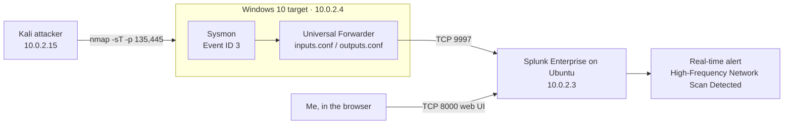

# Lab 1: Splunk detection lab

> Home lab. Everything here ran on my own laptop in VirtualBox. None of it is production or paid SOC work.

## What I built

I set up three virtual machines on a VirtualBox NAT Network. Kali attacks a Windows 10 machine. Windows logs network activity with Sysmon and sends it to Splunk Enterprise on Ubuntu Server through the Splunk Universal Forwarder. Splunk alerts me when it sees a burst of connections from one source.

The first goal was simple: run a port scan from Kali and prove I could see it in Splunk and get an alert.

## Architecture

| Machine | Role | IP |
|---|---|---|
| Kali Linux | Attacker | 10.0.2.15 |
| Windows 10 | Target, Sysmon, Universal Forwarder | 10.0.2.4 |
| Ubuntu Server | Splunk Enterprise (indexer and search head) | 10.0.2.3 |



In one line: attacker action → Sysmon → inputs.conf → outputs.conf → port 9997 → Splunk index → alert.


## Setup steps

These are in the order I did them.

### 1. Network

I put all three VMs on the same VirtualBox NAT Network so they can reach each other on 10.0.2.0/24 but stay off my home network.

### 2. Splunk Enterprise on Ubuntu (10.0.2.3)

I installed Splunk Enterprise, then opened two ports in UFW:

```bash
sudo ufw allow 8000/tcp   # Splunk web UI
sudo ufw allow 9997/tcp   # receiving data from forwarders
sudo ufw status
```

In Splunk I turned on receiving on port 9997 (Settings → Forwarding and receiving → Configure receiving).


### 3. Sysmon on Windows 10 (10.0.2.4)

I started with the SwiftOnSecurity Sysmon config. It filters out local network traffic, so my scan from Kali never showed up as Event ID 3. I switched to my own catch-all config, `C:\lab-sysmon.xml`, where NetworkConnect excludes nothing:

```xml
<NetworkConnect onmatch="exclude" />
```

An empty exclude rule means every network connection gets logged. That's too noisy for a real network, but fine for a three-machine lab.

```powershell
sysmon64.exe -c C:\lab-sysmon.xml
```

I also turned off Windows Defender Firewall on this VM so the scan could finish full TCP handshakes and create connection events.


### 4. Splunk Universal Forwarder on Windows

I pointed the forwarder at the Splunk server:

```powershell
cd "C:\Program Files\SplunkUniversalForwarder\bin"
.\splunk.exe add forward-server 10.0.2.3:9997
```

That command writes `outputs.conf`. Then I wrote `inputs.conf` by hand so the forwarder reads the Sysmon channel:

```ini
[WinEventLog://Microsoft-Windows-Sysmon/Operational]
disabled = 0
renderXml = true   # [CHECK: confirm this matches your inputs.conf]
```

Then I restarted the service:

```powershell
Restart-Service SplunkForwarder
```


### 5. Attack and search

From Kali:

```bash
nmap -sT -p 135,445 10.0.2.4
```

`-sT` is a full TCP connect scan, so each probe is a real connection that Sysmon can log. Ports 135 (RPC) and 445 (SMB) are common targets on Windows.

The Sysmon events reached Splunk as raw XML with no field extractions, so I searched the raw text instead of field names.


### 6. Alert

I saved the search as a real-time alert called **High-Frequency Network Scan Detected**, ran the scan again and checked that it fired.


## Detections

| # | What it detects | Query (SPL) | MITRE ATT&CK | Screenshot |
|---|---|---|---|---|
| 1 | Many network connections from one source in a short time, as seen during a TCP connect scan | See below | T1046 Network Service Discovery | [05](screenshots/05-splunk-search-event-id-3.png), [06](screenshots/06-triggered-alert.png) |

Detection 1, searched as raw XML:

```spl
index=main "Microsoft-Windows-Sysmon" "<EventID>3</EventID>"
| rex "<Data Name='SourceIp'>(?<src_ip>[^<]+)</Data>"
| rex "<Data Name='DestinationPort'>(?<dest_port>[^<]+)</Data>"
| stats count dc(dest_port) AS ports BY src_ip
| where count > [CHECK: threshold]
```

## MITRE ATT&CK mapping

| Technique | ID | Where it shows up |
|---|---|---|
| Network Service Discovery | T1046 | Nmap TCP connect scan of ports 135 and 445, logged as Sysmon Event ID 3 |

## What I learned

- A detection is only as good as what gets logged. The SwiftOnSecurity config is a good default, but it hid the exact traffic I wanted to see. I had to read the config to work out why.
- Host firewalls change what a scan looks like. With the firewall on, the handshakes didn't complete, so there was nothing for Sysmon to record as a connection.
- I don't need parsed fields to search. When the events came in as raw XML, I searched the text directly and used `rex` to pull values out.
- It helps to say the pipeline out loud: attacker action, Sysmon, inputs.conf, outputs.conf, port 9997, index, alert. When something broke, I checked each step in that order.

## Files

- [incident-report.md](incident-report.md): the scan written up as an incident
- [troubleshooting.md](troubleshooting.md): problems I hit and how I fixed them
