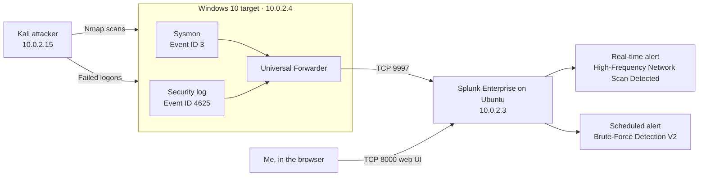
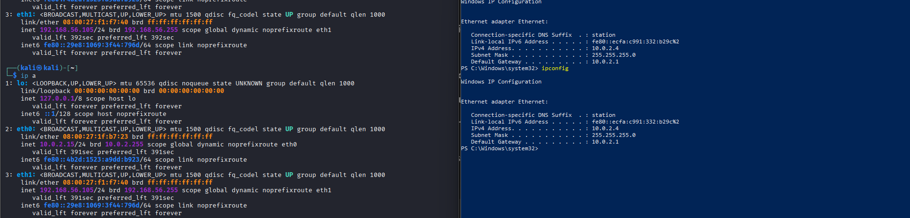
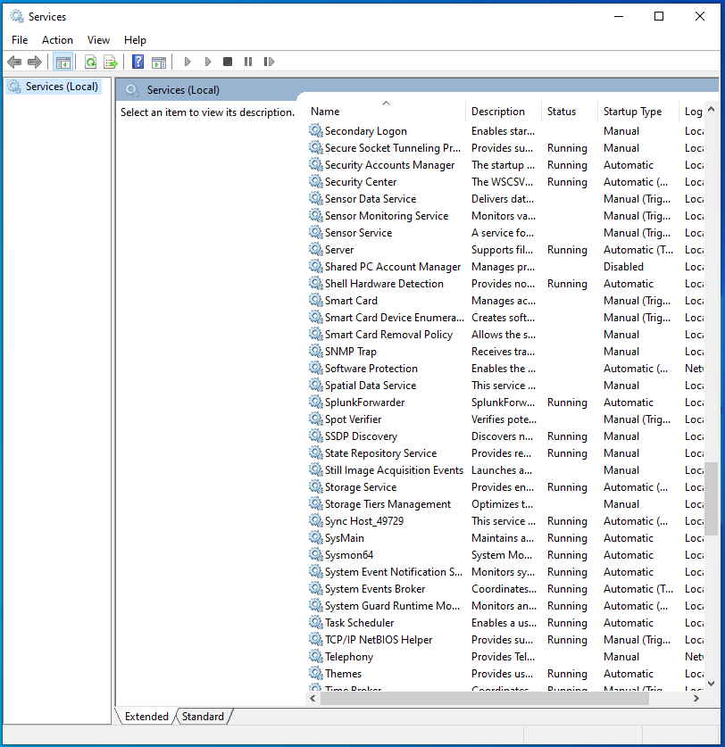
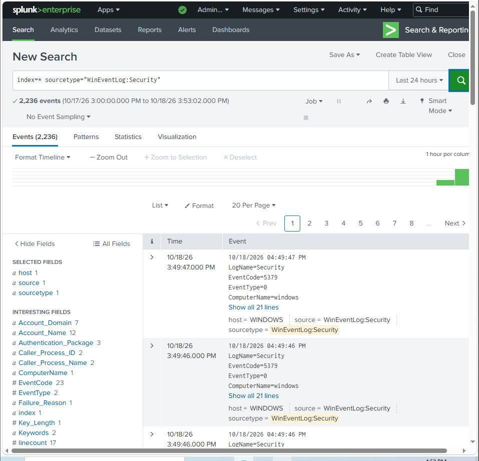
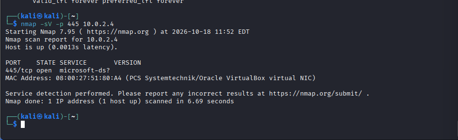
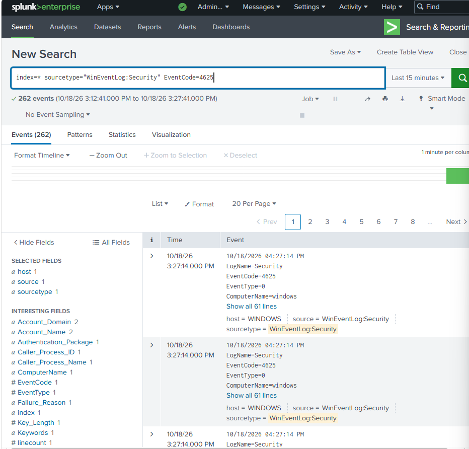
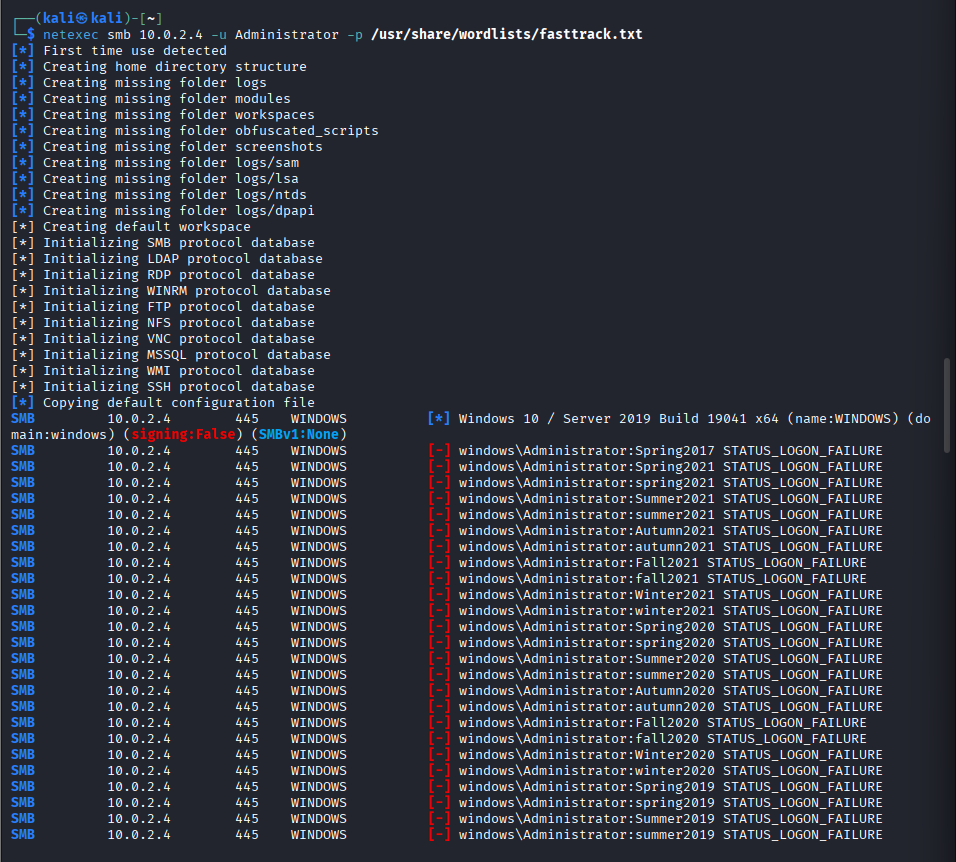
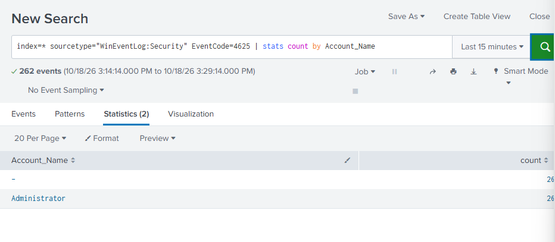
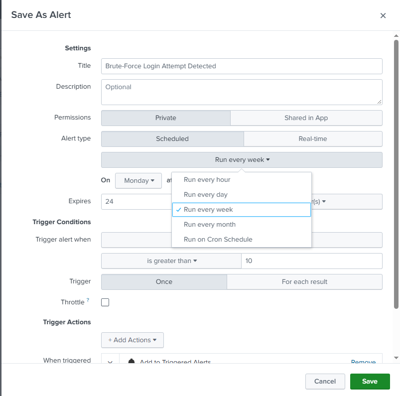
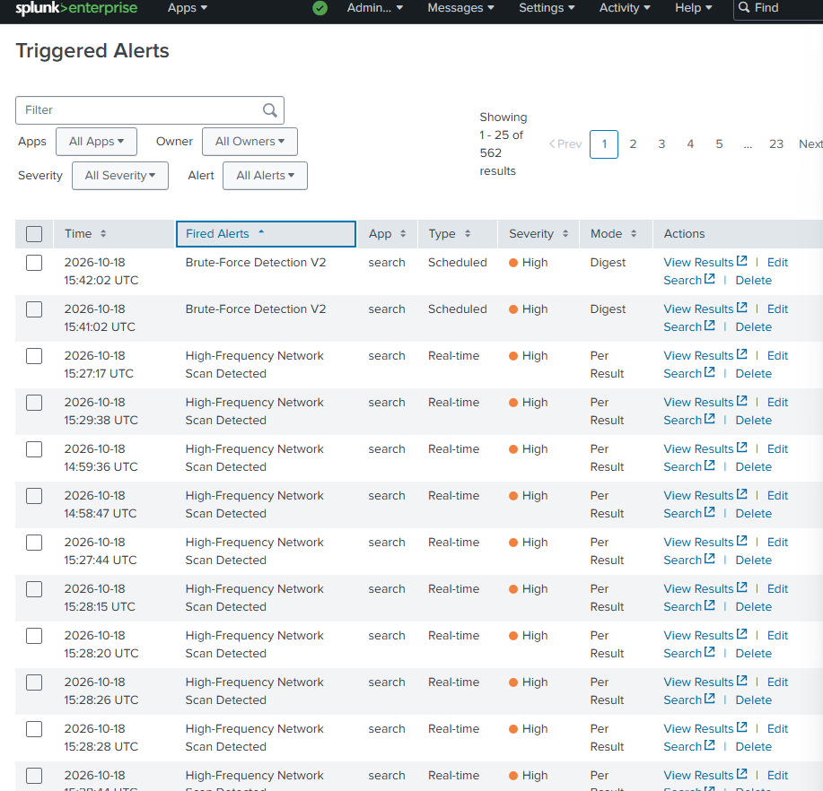

# Lab 1: Splunk detection lab

> Home lab. Everything here ran on my own laptop in VirtualBox. None of it is production or paid SOC work.

## What I built

I set up three virtual machines on a VirtualBox NAT Network. Kali attacks a Windows 10 machine. Windows sends its Sysmon and Security logs to Splunk Enterprise on Ubuntu Server through the Splunk Universal Forwarder.

I built two detections:

1. A real-time alert for network scanning, based on Sysmon Event ID 3 (network connection).
2. An alert for repeated failed logons, based on Windows Security Event ID 4625.

## Architecture

| Machine | Role | IP |
|---|---|---|
| Kali Linux | Attacker | 10.0.2.15 |
| Windows 10 (hostname WINDOWS) | Target, Sysmon, Universal Forwarder | 10.0.2.4 |
| Ubuntu Server | Splunk Enterprise | 10.0.2.3 |

The NAT Network gateway is 10.0.2.1. Kali also has a second, host-only adapter (eth1, 192.168.56.105). The attacks went to 10.0.2.4 over eth0.



In one line: attacker action → Sysmon or Security log → inputs.conf → outputs.conf → port 9997 → Splunk index → alert.



## Setup steps

These are in the order I did them.

### 1. Network

I put all three VMs on the same VirtualBox NAT Network so they can reach each other on 10.0.2.0/24 but stay off my home network.

### 2. Splunk Enterprise on Ubuntu (10.0.2.3)

I installed Splunk Enterprise, then opened two ports in UFW:

```bash
sudo ufw allow 8000/tcp   # Splunk web UI
sudo ufw allow 9997/tcp   # receiving data from forwarders
sudo ufw status
```

In Splunk I turned on receiving on port 9997 (Settings → Forwarding and receiving → Configure receiving).

### 3. Sysmon on Windows 10 (10.0.2.4)

I started with the SwiftOnSecurity Sysmon config. It filters out local network traffic, so my scan from Kali never showed up as Event ID 3. I switched to my own catch-all config, `C:\lab-sysmon.xml`, where NetworkConnect excludes nothing:

```xml
<NetworkConnect onmatch="exclude" />
```

An empty exclude rule means every network connection gets logged. That's too noisy for a real network, but fine for a three-machine lab.

I also turned off Windows Defender Firewall on this VM so scans could finish full TCP handshakes and create connection events.

### 4. Splunk Universal Forwarder on Windows

I pointed the forwarder at the Splunk server:

```powershell
cd "C:\Program Files\SplunkUniversalForwarder\bin"
.\splunk.exe add forward-server 10.0.2.3:9997
```

That command writes `outputs.conf`. Then I wrote `inputs.conf` by hand so the forwarder reads the Sysmon channel:

```ini
[WinEventLog://Microsoft-Windows-Sysmon/Operational]
disabled = 0
```

Then I restarted the service:

```powershell
Restart-Service SplunkForwarder
```

Sysmon64 and SplunkForwarder both run as automatic services, so they come back after a reboot.



The Windows Security log reaches Splunk too, as sourcetype `WinEventLog:Security` from host `WINDOWS`. Splunk extracts fields from these events, such as `EventCode` and `Account_Name`.



### 5. Scanning from Kali

I ran a TCP connect scan of two common Windows ports:

```bash
nmap -sT -p 135,445 10.0.2.4
```

`-sT` completes the full TCP handshake, so each probe is a real connection Sysmon can log.

I also ran a service version scan of port 445. Nmap reported 445/tcp open, `microsoft-ds`:

```bash
nmap -sV -p 445 10.0.2.4
```



The Sysmon events reached Splunk as raw XML with no field extractions, so I searched the raw text instead of field names.

### 6. Failed logons

I ran a password-guessing attack against the Administrator account over SMB from Kali, using netexec and the built-in fasttrack wordlist:

```bash
netexec smb 10.0.2.4 -u Administrator -p /usr/share/wordlists/fasttrack.txt
```

Every attempt came back `STATUS_LOGON_FAILURE`, so none of the passwords worked. The screenshot also shows the target as Windows 10 / Server 2019 Build 19041, SMB signing off, SMBv1 not present.



Each failed attempt wrote a Windows Security Event ID 4625. In the 15 minutes I searched, Splunk had 262 of them, all from host WINDOWS in domain `windows`.





### 7. Alerts

I saved the scan search as a real-time alert, **High-Frequency Network Scan Detected**, with severity High and Per Result mode.

I saved the failed-logon search as **Brute-Force Login Attempt Detected**, set to trigger once when the count was greater than 10 and add an entry to Triggered Alerts. I later tuned it into **Brute-Force Detection V2**, a scheduled alert in Digest mode with severity High, which is the version that fired on the Triggered Alerts page.



Both alerts fired on 18 October 2026.



## Detections

| # | What it detects | MITRE ATT&CK | Screenshots |
|---|---|---|---|
| 1 | A burst of network connections from one source, as seen during a port scan | T1046 Network Service Discovery | [03](screenshots/03-kali-nmap-sv-445.png), [04](screenshots/04-triggered-alerts.png) |
| 2 | Many failed logons in a short time | T1110 Brute Force | [06](screenshots/06-failed-logons-by-account.png), [07](screenshots/07-brute-force-alert-settings.png), [04](screenshots/04-triggered-alerts.png) |

**Detection 1 query (SPL), searched as raw XML:**

```spl
index=main "Microsoft-Windows-Sysmon" "<EventID>3</EventID>" "10.0.2.15"
```

> The alert counts Event ID 3 connections from a single source in a short window. The exact saved SPL may differ slightly from the line above.

**Detection 2 query (SPL):**

```spl
index=* sourcetype="WinEventLog:Security" EventCode=4625
| stats count by Account_Name
```

A note on the results: Event 4625 has two account names, the subject (who asked for the logon) and the target (the account being logged on to). For network logons the subject is empty, so Splunk shows one row as `-` and the other as `Administrator`.

## MITRE ATT&CK mapping

| Technique | ID | Where it shows up |
|---|---|---|
| Network Service Discovery | T1046 | Nmap scans of ports 135 and 445, logged as Sysmon Event ID 3 |
| Brute Force | T1110 | Repeated failed logons to Administrator, logged as Security Event ID 4625 |

## What I learned

- A detection is only as good as what gets logged. The SwiftOnSecurity config is a good default, but it hid the exact traffic I wanted to see. I had to read the config to work out why.
- Host firewalls change what a scan looks like. With the firewall on, the handshakes didn't complete, so there was nothing for Sysmon to record as a connection.
- I don't need parsed fields to search. When the Sysmon events came in as raw XML, I searched the text directly.
- Alert settings matter as much as the search. The scan alert in Per Result mode fires once for every matching event, so one scan produced a long list of alerts.
- It helps to say the pipeline out loud: attacker action, log source, inputs.conf, outputs.conf, port 9997, index, alert. When something broke, I checked each step in that order.

## Files

- [incident-report.md](incident-report.md): the scan written up as an incident
- [troubleshooting.md](troubleshooting.md): problems I hit and how I fixed them
